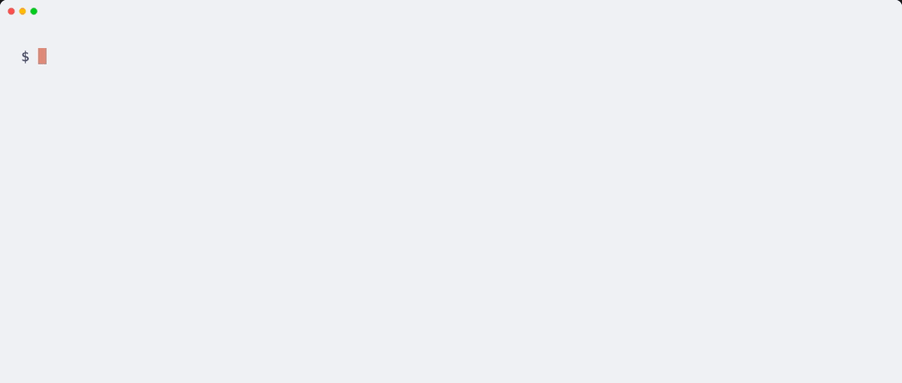

<div align="center">


# git-dirty-triage
[English](README.md)

원격 저장소보다 뒤처진 작업 폴더에서 아직 게시하지 않은 변경을 가려내는 Git 명령입니다.

Python 3.9+ · Git 2.x

[](https://pypi.org/project/git-dirty-triage/)
[](https://github.com/elfenomenokim/git-dirty-triage/blob/main/LICENSE)

따뜻한 캐시의 macOS 체크아웃 하나에서 107초에 38,925개 경로를 분류했습니다.

[설치](#설치) · [시작하기](#시작하기) · [만든 이유](#만든-이유)

</div>

<p align="center">
<picture>
  <source media="(prefers-color-scheme: dark)" srcset="https://raw.githubusercontent.com/elfenomenokim/git-dirty-triage/main/docs/demo/dark.gif">
  
</picture>
</p>

영상은 임시 원격 저장소와 복제본 두 개로 기록했습니다. 한쪽은 커밋 7개를 게시하고, 다른 쪽은 뒤처진 상태에서 파일을 수정합니다. [재현 코드와 녹화 소스](docs/demo/).

## 설치

```sh
pipx install git-dirty-triage
uv tool install git-dirty-triage
pip install git-dirty-triage
```

Python 3.9 이상과 Git 2.x가 필요합니다. 추가 Python 패키지는 없습니다. 설치하면 `git dirty-triage`로도 실행할 수 있습니다.

macOS arm64와 Python 3.12에서 확인했습니다. Linux와 Windows 실행은 확인하지 않았습니다.

## 시작하기

작업 폴더에서 실행하면 먼저 원격을 fetch한 뒤 변경된 경로를 분류합니다. 아래 출력은 함께 제공하는 임시 저장소에서 얻었습니다.

```console
$ git-dirty-triage
checkout is 7 commits behind origin/main
5 changed tracked files: 3 already published, 1 unpublished, 1 needs a decision · 3 untracked entries (1 already on the remote)
      2  identical         same bytes as the remote
      1  stale             an earlier published version of the remote file
      1  contained         the remote already holds every line
      1  new               not on the remote
      1  differs_clean     unpublished edit, merges cleanly
      1  differs_conflict  needs a decision, conflicting lines
      1  untracked_dir     untracked directory, not expanded
        differs_conflict     0 min ago  conflict.txt  1 unique line(s)
        differs_clean        0 min ago  merge.txt  1 unique line(s)
        untracked_dir                  build/  3 file(s)
        new                  0 min ago  new.txt
```

```console
$ git-dirty-triage --print-unpublished
merge.txt
new.txt
```

```console
$ git-dirty-triage --prefix build
checkout is 7 commits behind origin/main
1 untracked entry
      1  untracked_dir     untracked directory, not expanded
        untracked_dir                  build/  3 file(s)
```

`merge.txt`와 `new.txt`는 아직 게시하지 않은 변경입니다. `conflict.txt`는 충돌을 직접 판단해야 합니다. 추적하지 않는 `build/`는 `--untracked all`을 붙이기 전까지 한 줄로 남습니다.

## 만든 이유

여러 세션이 작업 폴더 하나를 쓰면, 다른 세션이 파일 내용을 게시해도 내 브랜치와 인덱스는 그대로일 수 있습니다. `git status`는 내 인덱스와 비교하므로 이미 게시한 파일도 수정 상태로 보여 줍니다. 다시 커밋하기 전에 새 작업과 지난 작업을 가려야 합니다.

이 명령은 현재 파일을 원격 최신 버전과 이전에 게시된 버전에 대조합니다. 이미 게시된 내용, 새 변경, 충돌을 구분합니다. 일반 조회는 브랜치·인덱스·작업 파일을 바꾸지 않습니다. 다만 기본 fetch는 원격 추적 ref를 갱신합니다.

| 도구 | 살펴볼 대상 |
|---|---|
| `git status`, `git diff` | 내 인덱스나 로컬 커밋과의 차이 |
| `git log`, `git range-diff` | 커밋 이력과 커밋 묶음의 차이 |
| `git-dirty-triage` | 원격에 게시된 내용보다 뒤처진 작업 폴더의 파일 |

작업 폴더가 이미 원격을 따라가고 있다면 `git status`부터 쓰면 됩니다.

## 측정

이전에 Apple silicon Mac과 Python 3.12에서 캐시가 따뜻한 상태로 **38,925개 경로를 107초**에 분류했습니다. 특정 작업 폴더 한 번의 관측이며 처리량을 보장하지 않습니다. 실제로 다른 파일은 경로별 이력과 내용을 읽습니다. `--prefix`로 담당 폴더만 좁히면 조회 범위도 줄어듭니다.

## 옵션

| 옵션 | 동작 |
|---|---|
| `--repo PATH` | 현재 폴더 대신 지정한 저장소 조회 |
| `--remote NAME`, `--branch NAME` | 비교 ref 선택, 원격 기본값은 `origin` |
| `--prefix PATH` | 저장소 기준 상대 경로로 조회·출력 범위 제한, 반복 가능 |
| `--json` | 전체 분류와 합계를 JSON으로 출력 |
| `--print-unpublished` | 미게시 경로를 한 줄에 하나씩 출력 |
| `--untracked normal` | 미추적 폴더를 파일 수와 함께 한 줄로 출력, 기본값 |
| `--untracked all` | 미추적 폴더 안의 파일을 개별 분류 |
| `--untracked no` | 미추적 경로 제외 |
| `--ahead` | 작업 파일이 깨끗해도 로컬에만 있는 커밋의 경로 조회 |
| `--no-fetch` | 마지막으로 fetch한 ref 사용 |
| `--commit-unpublished -m MESSAGE` | 원격 최신 커밋 위에 새 커밋 작성, push는 하지 않음 |

설정 파일과 전용 환경 변수는 없습니다. `--branch`가 없으면 원격 기본 브랜치, `main`, `master` 순으로 찾습니다.

### 분류

<picture>
  <source media="(prefers-color-scheme: dark)" srcset="https://raw.githubusercontent.com/elfenomenokim/git-dirty-triage/main/docs/diagrams/classify-flow-dark.ko.svg">
  
</picture>

이 그림은 분류 결과를 묶어 보여 줍니다. contained는 줄의 순서까지 같다는 뜻이 아니며, 펼치지 않은 미추적 폴더는 내용 비교를 하지 않습니다.

| 분류 | 뜻 | 커밋 후보 |
|---|---|---|
| `identical` | 원격과 바이트가 같음 | 제외 |
| `stale` | 과거에 게시된 버전과 바이트가 같음 | 제외 |
| `contained` | 비어 있지 않은 로컬 줄이 모두 원격에 있음 | 제외 |
| `new` | 원격에 해당 파일이 없음 | 포함 |
| `differs_clean` | 새 줄이 있고 3-way 병합이 성공함 | 포함 |
| `differs_conflict` | 3-way 병합 충돌 | 직접 판단 |
| `differs_binary` | 바이너리가 다름 | 원격이 HEAD 이후 바뀌지 않았을 때만 포함 |
| `deleted` | 작업 파일이 삭제됨 | 보고만 |
| `untracked_dir` | 펼치지 않은 미추적 폴더 | 보고만 |
| `skipped` | 심볼릭 링크·이름에 줄바꿈이 있는 경로 등 | 보고만 |

`contained`는 줄의 포함 여부를 보는 휴리스틱입니다. 줄의 순서와 반복 횟수까지 같다는 뜻은 아닙니다. 순서만 바꾼 수정은 직접 확인하세요.

### 커밋 작성

```sh
git-dirty-triage --commit-unpublished -m "Update the parser"
```

임시 인덱스를 사용해 원격 최신 커밋을 부모로 삼습니다. 결과는 `refs/git-dirty-triage/<branch>`에 보관합니다. 현재 브랜치·인덱스·작업 폴더는 그대로 둡니다. push 명령을 안내하지만 실행하지는 않습니다.

`differs_clean`의 커밋 내용은 3-way 병합 결과라서 작업 파일과 다를 수 있습니다. 충돌·삭제·건너뛴 경로·펼치지 않은 폴더는 제외합니다. 미게시라는 분류가 곧 게시해도 된다는 뜻은 아니므로 선택된 변경을 먼저 확인하세요.

### JSON과 종료 코드

`--json`은 `repo`, `ref`, `behind`, `mode`, `counts`, `summary`, `paths`를 반환합니다. `summary`는 추적 파일과 미추적 항목을 나눕니다. 분류별 합계에는 둘 다 포함됩니다. 경로에는 `class`, `reason`, `untracked`, `files`가 있습니다. `files`는 펼치지 않은 폴더의 파일 수이며 나머지는 `null`입니다.

종료 코드 **0**은 보고서 출력 성공입니다. 충돌이 있어도 0입니다. **2**는 사용법 또는 Git 오류입니다. 커밋할 내용이 없을 때도 커밋 모드는 0으로 끝납니다.

## 한계

- fetch가 실패하면 경고를 내고 마지막으로 받은 ref와 비교합니다. 이때 보고서는 원격 현재 상태가 아닐 수 있습니다.
- `stale`은 과거에 게시됐다는 뜻이고, `contained`는 줄이 포함됐다는 뜻입니다. 현재 원격과 의미까지 같음을 보장하지 않습니다.
- 이름 변경은 삭제와 추가로 나옵니다. 삭제는 보고만 하며 커밋하지 않습니다.
- 미추적 폴더는 `--untracked all` 전까지 파일 수만 세고 내용은 비교하지 않습니다.
- `--ahead`는 merge-base가 필요합니다. 깊이 1인 shallow clone에는 없을 수 있습니다.
- 원격 최신 커밋이 없는 빈 저장소는 지원하지 않습니다.
- Linux·Windows에서는 실행하지 않았습니다. 저장된 성능 수치는 macOS 작업 폴더 하나의 결과입니다.

## 기여

버그나 실행 결과는 [이슈](https://github.com/elfenomenokim/git-dirty-triage/issues)에 남겨 주세요. 소스 확인 명령: `python3 -m compileall -q src`와 `docs/demo/make-repo.sh` 픽스처입니다. 리뷰 방식은 [CONTRIBUTING.md](CONTRIBUTING.md), 작업 구조와 주의사항은 [AGENTS.md](AGENTS.md)에 있습니다.

## 라이선스

MIT입니다. [LICENSE](LICENSE)를 보세요.
