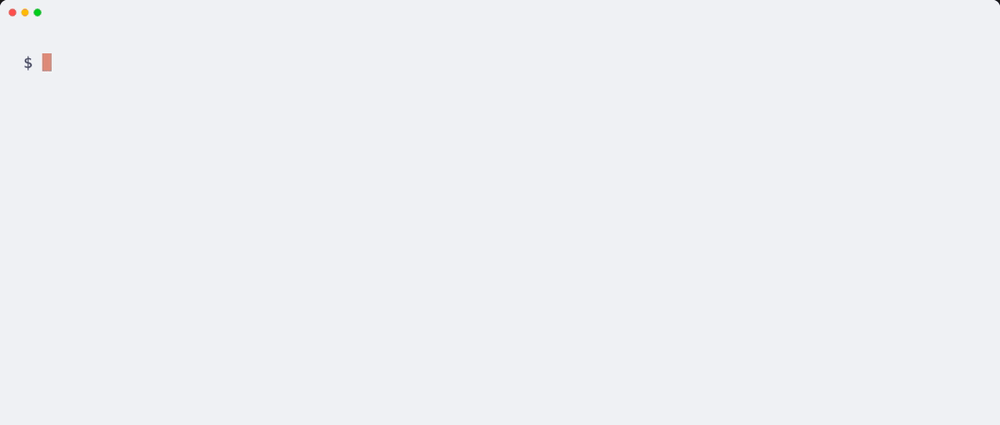

<div align="center">


# git-dirty-triage
[한국어](README.ko.md)

A Git command that separates unpublished edits from work already on the remote.

Python 3.9+ · Git 2.x

[](https://pypi.org/project/git-dirty-triage/)
[](https://github.com/elfenomenokim/git-dirty-triage/blob/main/LICENSE)

38,925 paths classified in 107 seconds on one warm-cache macOS checkout.

[Install](#install) · [Quick start](#quick-start) · [Why](#why)

</div>

<p align="center">
<picture>
  <source media="(prefers-color-scheme: dark)" srcset="https://raw.githubusercontent.com/elfenomenokim/git-dirty-triage/main/docs/demo/dark.gif">
  
</picture>
</p>

The demo uses a throwaway remote and two clones. One clone publishes seven commits; the other keeps local edits. [Fixture and tape](docs/demo/).

## Install

```sh
pipx install git-dirty-triage
uv tool install git-dirty-triage
pip install git-dirty-triage
```

Python 3.9+, Git 2.x, and no Python dependencies. The installed command also works as `git dirty-triage`.

Verified on macOS arm64 with Python 3.12. Linux and Windows have not been exercised.

## Quick start

Run it from your checkout. It fetches the remote first, then classifies the changed paths. These outputs were captured from the bundled throwaway repository.

```console
$ git-dirty-triage
checkout is 7 commits behind origin/main
5 changed tracked files: 3 already published, 1 unpublished, 1 needs a decision · 3 untracked entries (1 already on the remote)
      2  identical         same bytes as the remote
      1  stale             an earlier published version of the remote file
      1  contained         the remote already holds every line
      1  new               not on the remote
      1  differs_clean     unpublished edit, merges cleanly
      1  differs_conflict  needs a decision, conflicting lines
      1  untracked_dir     untracked directory, not expanded
        differs_conflict     0 min ago  conflict.txt  1 unique line(s)
        differs_clean        0 min ago  merge.txt  1 unique line(s)
        untracked_dir                  build/  3 file(s)
        new                  0 min ago  new.txt
```

```console
$ git-dirty-triage --print-unpublished
merge.txt
new.txt
```

```console
$ git-dirty-triage --prefix build
checkout is 7 commits behind origin/main
1 untracked entry
      1  untracked_dir     untracked directory, not expanded
        untracked_dir                  build/  3 file(s)
```

`merge.txt` and `new.txt` carry unpublished work. `conflict.txt` needs a decision. The untracked `build/` directory stays one row unless you pass `--untracked all`.

## Why

In a shared checkout, another session can publish your bytes without moving your local branch or index. `git status` still calls those files modified because it compares them with your index. That leaves you sorting old work from new work before every commit.

This command compares the working files with the remote tip and earlier published versions. It separates already-published bytes, new edits, and conflicts. A normal report does not change your branch, index, or working files; the default fetch does update remote-tracking refs.

| Tool | Use it for |
|---|---|
| `git status` / `git diff` | Changes against your own index or local commit |
| `git log` / `git range-diff` | Commit history and differences between commit series |
| `git-dirty-triage` | Working files in a checkout that lags behind published work |

If your checkout already follows the remote, start with `git status`.

## Measurement

A previous warm-cache run classified **38,925 paths in 107 seconds** on an Apple-silicon Mac with Python 3.12. This is one observed checkout, not a throughput guarantee. Unique differences require per-path history and content reads; use `--prefix` to limit the work to your directory.

## Reference

| Option | What you get |
|---|---|
| `--repo PATH` | Inspect that checkout instead of the current directory |
| `--remote NAME`, `--branch NAME` | Choose the comparison ref; remote defaults to `origin` |
| `--prefix PATH` | Limit the scan and report to a repo-relative prefix; repeatable |
| `--json` | Full report, counts and per-path classifications |
| `--print-unpublished` | One unpublished path per line |
| `--untracked normal` | One row per untracked directory, with a file count; default |
| `--untracked all` | Expand untracked directories into file rows |
| `--untracked no` | Omit untracked paths |
| `--ahead` | Inspect paths touched by local-only commits, even with clean working files |
| `--no-fetch` | Use the last fetched ref |
| `--commit-unpublished -m MESSAGE` | Build a commit on the remote tip; do not push |

There is no configuration file or tool-specific environment variable. With no `--branch`, the tool tries the remote's default branch, then `main`, then `master`.

### Classes

<picture>
  <source media="(prefers-color-scheme: dark)" srcset="https://raw.githubusercontent.com/elfenomenokim/git-dirty-triage/main/docs/diagrams/classify-flow-dark.svg">
  
</picture>

This groups classification outcomes. Contained does not prove equivalent line order; opaque untracked directories are counted without content comparison.

| Class | Meaning | Commit candidate? |
|---|---|---|
| `identical` | Same bytes as the remote | No |
| `stale` | Same bytes as an earlier published version | No |
| `contained` | Every nonblank local line is already in the remote file | No |
| `new` | No remote file at that path | Yes |
| `differs_clean` | Unique lines; three-way merge succeeds | Yes |
| `differs_conflict` | Three-way merge conflicts | Needs a decision |
| `differs_binary` | Binary difference | Only if remote bytes are unchanged since HEAD |
| `deleted` | Working file removed | Report only |
| `untracked_dir` | Unexpanded directory | Report only |
| `skipped` | Unsupported path, such as a symlink or newline in a name | Report only |

`contained` is a line-membership heuristic. It does not preserve line order or repetition, so it cannot establish semantic equivalence. Review reorder-only changes yourself.

### Build a commit

```sh
git-dirty-triage --commit-unpublished -m "Update the parser"
```

The commit uses a temporary index and the remote tip as its parent. It keeps a private ref under `refs/git-dirty-triage/<branch>`. Your current branch, index and working tree stay as they were; the command prints a suggested push command but does not run it.

For `differs_clean`, the committed bytes are the three-way merge, which can differ from your working file. Conflicting, deleted, skipped, and opaque directory rows are excluded. Unpublished does not mean ready to publish: inspect the selected changes before using this option.

### JSON and exits

`--json` returns `repo`, `ref`, `behind`, `mode`, `counts`, `summary`, and `paths`. `summary` separates tracked changes from untracked entries; per-class counts include both. Every path has `class`, `reason`, `untracked`, and `files` (a count for opaque directories, otherwise `null`).

Exit **0** means the report was produced, even if it contains conflicts. Exit **2** means a usage or Git error. Commit mode also exits 0 when there is nothing to commit.

## Limits

- A failed fetch prints a warning and uses the last fetched ref. The report then describes that cached state.
- `stale` means previously published, not equal to the current remote. `contained` compares lines, not meaning.
- Renames appear as deletion plus addition. Deleted paths are reported, never committed.
- Untracked directories are counted but not hashed or compared unless expanded with `--untracked all`.
- `--ahead` needs a merge base; a depth-one shallow clone may lack one.
- Empty repositories without a remote tip are unsupported.
- Linux and Windows are untested. The saved measurement covers one macOS checkout only.

## Contributing

Issues and platform reports are welcome; run `python3 -m compileall -q src` from the source checkout and the fixture in `docs/demo/make-repo.sh`. See [CONTRIBUTING.md](CONTRIBUTING.md) for the review process and [AGENTS.md](AGENTS.md) for the code layout and safety rules.

## License

MIT. See [LICENSE](LICENSE).
